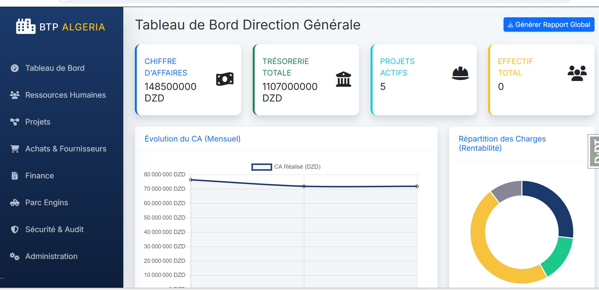
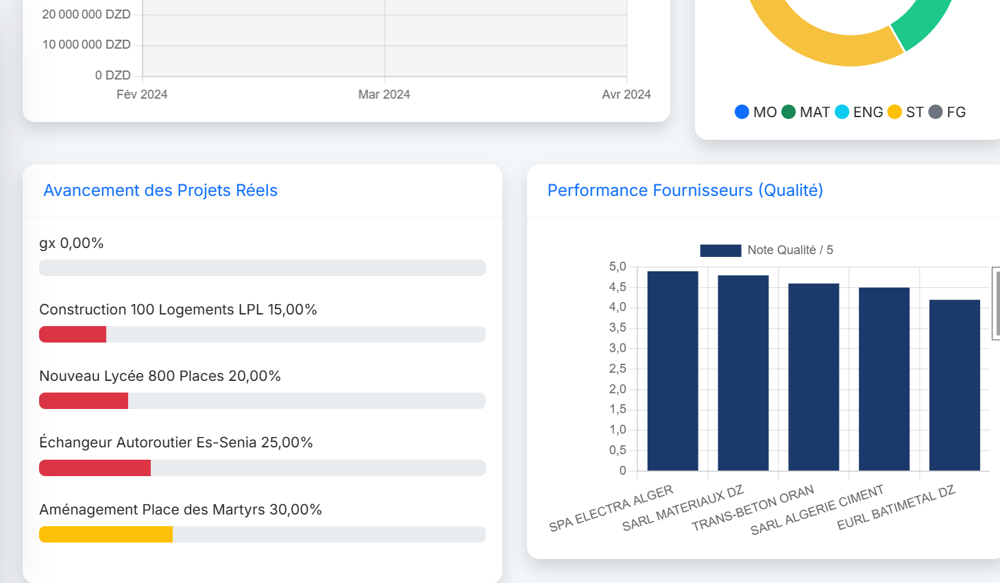
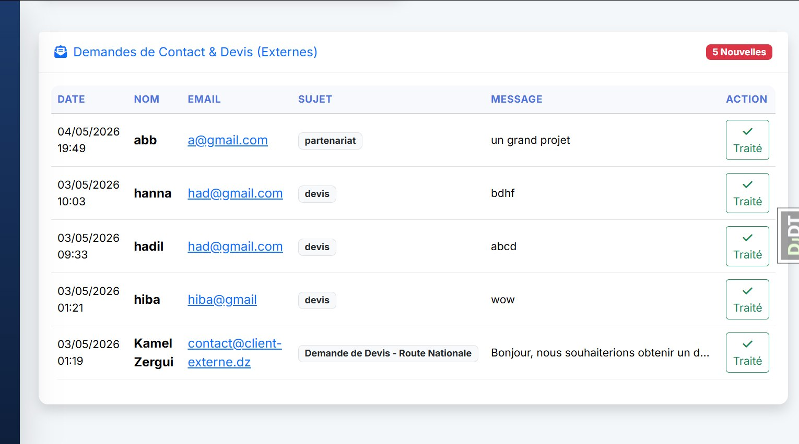
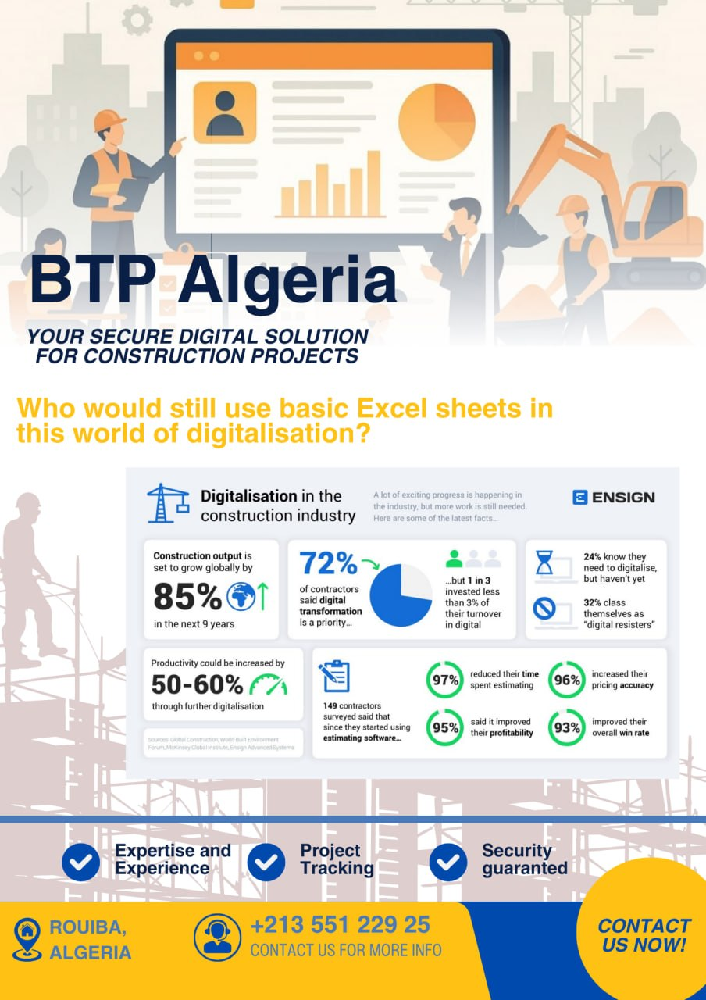

<div align="center">

<!-- ✦ BANNIÈRE ANIMÉE : CYBERSÉCURITÉ ✦ -->


### *Système de Gestion Intégré Sécurisé pour les Entreprises du BTP*


</div>

---

## 🛡️ Sécurité : Le Cœur du Système

La sécurité n'est pas une option, c'est la fondation de **BTP Algeria**. Contrairement aux logiciels classiques où la sécurité est ajoutée à la fin, notre plateforme a été pensée **"Security First"**. Chaque donnée sensible est protégée, chaque accès est contrôlé.

| Mécanisme de Défense | Implémentation Technique | Statut |
|:---|:---|:---:|
| **Authentification Forte** | 2FA (TOTP) via Google Authenticator, politique de mots de passe stricts (historique + expiration). | ✅ |
| **Contrôle d'Accès (RBAC)** | 9 niveaux de rôles distincts, isolation totale des données par utilisateur. | ✅ |
| **Chiffrement des Données** | AES-256 pour toutes les données sensibles au repos. | ✅ |
| **Journalisation Immuable** | Table `AuditLog` infalsifiable (aucun UPDATE/DELETE possible). | ✅ |
| **Protection Anti-DoS** | Blocage automatique des IP après 5 tentatives échouées (`django-axes`). | ✅ |
| **Intégrité des Données** | Hachage cryptographique pour détecter toute modification non autorisée. | ✅ |

> 💡 *Pour une analyse détaillée des mesures de sécurité, consultez le fichier [`SECURITY_CHECKLIST.md`](SECURITY_CHECKLIST.md).*

---

## ✦ À propos du projet

**BTP Algeria** est une plateforme web de gestion complète conçue pour les entreprises du bâtiment et des travaux publics en Algérie. Le système centralise les opérations administratives, financières, humaines et opérationnelles.

Développé avec **Django**, **PostgreSQL** et une architecture sécurisée, il respecte les spécificités algériennes : **Dinar Algérien (DZD)**, **Système Comptable Financier (SCF)**, **loi 90-11**, et **décret 15-247**.

---

## ✦ Fonctionnalités Principales

| ✦ | Module | Description |
|:---:|:---|:---|
| 👥 | **Comptes & Authentification** | Gestion des utilisateurs, RBAC, 2FA. |
| 💼 | **Gestion des Employés** | Dossiers du personnel, paie (DZD), congés. |
| 🏗️ | **Gestion des Projets** | Suivi des chantiers, situations de travaux, rentabilité. |
| 🚚 | **Gestion des Fournisseurs** | Achats, devis, stocks et facturation. |
| 💰 | **Gestion Financière** | Comptabilité SCF, trésorerie et suivi fiscal. |
| 🚜 | **Parc Automobile** | Suivi des engins, maintenance et carburant. |
| 🛡️ | **Audit & Sécurité** | Journalisation immuable des opérations sensibles. |
| 📊 | **Dashboard** | KPIs en temps réel, graphiques et alertes. |

---

## ✦ Aperçu de l'Application

<div align="center">

### 📊 Tableau de Bord Direction Générale


### 📈 Suivi des Projets & Fournisseurs


### 📩 Demandes de Contact & Devis


### 🖼️ Posters de Présentation
<p align="center">
  
</p>

</div>

---

## ✦ Stack Technique

| Technologie | Rôle |
|:---|:---|
| **Python & Django** | Framework web et logique métier |
| **PostgreSQL** | Base de données relationnelle sécurisée |
| **Redis** | Cache & Broker (Sessions sécurisées) |
| **Docker & Docker Compose** | Conteneurisation et isolation |
| **HTML, CSS, JavaScript** | Interface utilisateur (Bootstrap 5) |
| **django-encrypted** | Chiffrement AES-256 des données |

---

## ✦ Installation Locale

**1. Cloner le dépôt**
```bash
git clone https://github.com/had200/BTP-ALGERIA.git
cd BTP-ALGERIA
```

**2. Créer un environnement virtuel**
```bash
python -m venv venv
# Windows
venv\Scripts\activate
# Linux / macOS
source venv/bin/activate
```

**3. Installer les dépendances**
```bash
pip install -r requirements.txt
```

**4. Configurer les variables d'environnement**
Copier le fichier `.env.example` vers `.env`, puis renseigner les paramètres nécessaires.
> ⚠️ *Ne jamais publier le fichier `.env` ni y inscrire des identifiants réels.*

**5. Démarrer les services (Docker)**
```bash
docker compose up -d
```

**6. Appliquer les migrations**
```bash
python manage.py migrate
```

**7. Lancer le serveur**
```bash
python manage.py runserver
```
L'application sera accessible à l'adresse : `http://127.0.0.1:8000/`

---

## ✦ Documentation & Rapport de Sécurité

Pour plus de détails sur l'architecture, les protocoles de sécurité et les spécificités algériennes implémentées, veuillez consulter notre rapport de projet complet :

👉 **[📄 Télécharger le Rapport de Projet (PDF)](rapport_btp_final.pdf)**

---

<div align="center">


### ✦ BTP ALGERIA ✦

*Votre solution numérique sécurisée pour les projets de construction*

📞 **+213 551 229 25** | 📍 **Rouiba, Algérie**

*© 2025-2026 — Réalisé par Chebira Nour El Hana, Rekkab Amani Lyna, Laouar Cheurfa Hiba, Boudaren Hadil.*

</div>
